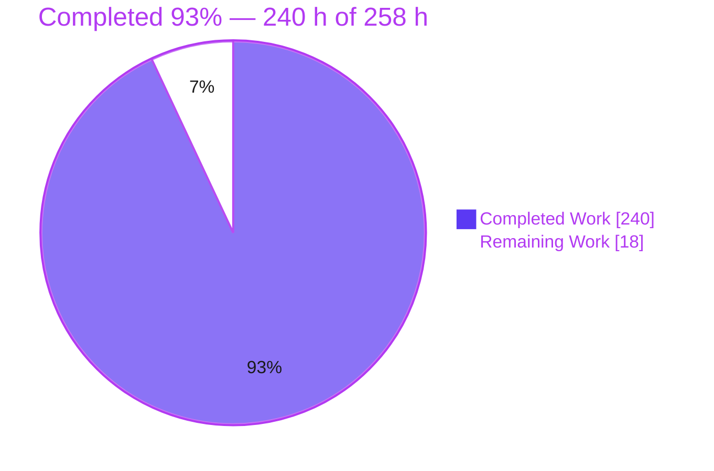
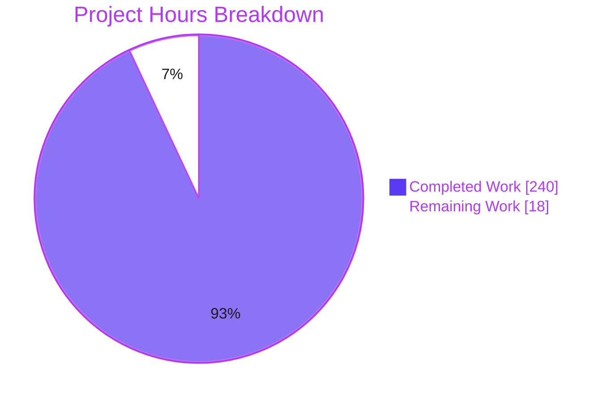
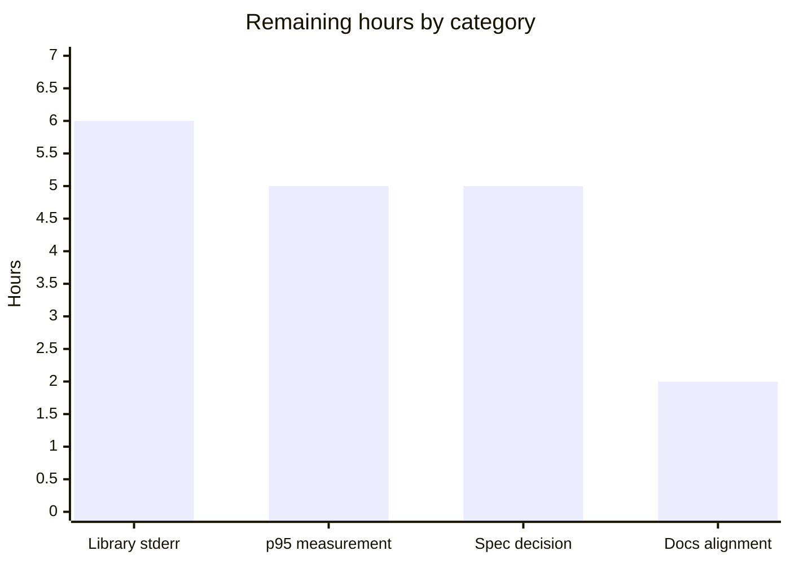

# 1. Executive Summary

## 1.1 Project Overview

`finmail` is a Python 3.12 command-line application that replaces a daily manual check of the Yahoo Finance website with one e-mail. A run reads a YAML configuration of up to 50 tickers, collects each symbol's daily bars in sequence, renders a market summary in plain text and HTML — one line per asset, pt-BR number formatting, sign plus colour for the variation, a fixed source footer — and delivers it as one message to up to 20 recipients over SMTP with STARTTLS. Three subcommands cover the operator's day: `run`, `run --dry-run` and `check-config`. It is started by `cron`, keeps no state between runs, logs to stdout and reports its outcome through a five-value exit-code contract.

## 1.2 Completion Status

240 of the 258 hours of scoped work are complete — **93%**. The remaining 18 hours cover one open stream-contract item, one manual performance measurement, one specification decision and one documentation alignment (Section 2.2).



| Metric | Hours |
|---|---|
| Total Hours | 258 |
| Completed Hours (AI + Manual) | 240 |
| Remaining Hours | 18 |
| **Completion** | **93%** |

## 1.3 Key Accomplishments

- One multipart message per run, all recipients in a single `To` header, text part before HTML part (`finmail/mailer.py`).
- Quote collection confined to one adapter over Yahoo Finance, three bounded attempts, per-asset degradation instead of failure (`finmail/quotes.py`).
- Configuration validated field by field before any network contact, with operator messages naming the offending field (`finmail/config.py`).
- A five-value exit-code contract and stream discipline that keeps every log line and all data on stdout and one diagnostic line on stderr on every ordinary path (`finmail/cli.py`).
- Server-rendered bodies with pt-BR formatting, sign-plus-colour variation semantics and `dados indisponíveis` rows for failed assets (`finmail/report.py`, `finmail/templates/`).
- A 285-test offline suite, including five end-to-end tests that drive the real CLI against a local STARTTLS peer (`tests/test_end_to_end.py`).
- Live collection verified: numeric closes and trade dates for `AAPL` and `PETR4.SA` in 1.1 s for two assets.
- Operator documentation covering install, configuration, `cron`, exit codes and two manual verification procedures (`README.md`).

## 1.4 Critical Unresolved Issues

Four of the 50 specification requirements tracked by this assessment remain open, at the requirement grain the specification uses. None of the eight acceptance criteria is among them.

| Issue | Impact | Owner | ETA |
|---|---|---|---|
| The quote library can write its own diagnostic to stderr on some failing-symbol runs, beyond the documented single diagnostic line | An extra stderr line can confuse log-based alerting; the fatal line stays single and last | Maintainer | 1 day (6 h) |
| The 50-ticker p95 measurement the run budget depends on has not been executed | The 120 s budget is projected (~19 s) rather than observed | Maintainer | 1 day (5 h) |
| The specification asks for one HTTP request per ticker while the mandated metadata accessor adds a library-internal request | ~0.35 s extra per ticker; documentation and behaviour disagree on the request count | Specification owner | 1 day (5 h) |
| Two README statements no longer match delivered behaviour (exit-code row 1, request-count sentence) | A reader comparing the documentation with a run finds a contradiction | Maintainer | 0.5 day (2 h) |

## 1.5 Access Issues

| System/Resource | Type of Access | Issue Description | Resolution Status | Owner |
|---|---|---|---|---|
| Operator SMTP account (host, port, username, password) | Service credentials | No production SMTP account is provisioned in this environment, so delivery is verified against a local STARTTLS peer with a fictitious credential pair | Verified locally; a real account is the operator's to provision | Operator |

## 1.6 Recommended Next Steps

1. **[High]** Contain the quote library's own diagnostics so a failing-symbol run writes nothing to stderr but the product's single line; add the regression test.
2. **[High]** Provision the operator SMTP account and confirm one real delivery before the first scheduled run.
3. **[Medium]** Execute and record the 50-ticker, 20-run p95 measurement beside the procedure in `README.md`.
4. **[Medium]** Decide whether the one-request-per-ticker wording or the metadata source changes, then align code docstrings, `README.md` and `tests/test_quotes.py` with that decision.
5. **[Low]** Bring the exit-code table's row 1 and the request-count sentence in `README.md` in line with delivered behaviour.

# 2. Project Hours Breakdown

## 2.1 Completed Work Detail

| Component | Hours | Description |
|---|---|---|
| Packaging and repository foundation | 8 | `pyproject.toml` with seven exact pins, package data for the templates, `finmail/__init__.py` version constant, `python -m finmail` entry point, `.gitignore`, `.env.example` |
| Configuration contract | 34 | `finmail/config.py` (598 lines) and `tests/test_config.py` (83 tests): six-key schema, defaults `587` and `America/Sao_Paulo`, unknown-key rejection naming the key, first-error order, credential sourcing from the environment, operator diagnostics |
| Yahoo Finance adapter | 32 | `finmail/quotes.py` (294 lines), `tests/test_quotes.py` (38 tests) and the offline double: ten-field derivation from a one-year daily window, three bounded attempts two seconds apart, deterministic errors never retried, pt-BR reasons, the public metadata accessor only |
| Report rendering | 30 | `finmail/report.py` (266 lines), `report.txt.j2`, `report.html.j2` (105 lines) and `tests/test_report.py` (65 tests): injected clock, pt-BR formatting, sign-plus-colour variation, `n/d`, degradation rows, HTML autoescape by extension, footer |
| SMTP delivery | 34 | `finmail/mailer.py` (482 lines) and `tests/test_mailer.py` (44 tests): MIME assembly with both parts, STARTTLS transaction order, certificate and hostname verification, failure classification with 5 s and 30 s retries, credential custody |
| CLI composition root | 40 | `finmail/cli.py` (829 lines) and `tests/test_cli.py` (50 tests): argument surface with the global `--config`, exit-code map, stream discipline including a failed stdout, log format and level discipline, branch-local imports, orchestration |
| Offline test harness | 28 | `tests/conftest.py` (873 lines), `tests/fixtures/guard/sitecustomize.py` (241 lines), the quotation double, the local certificate and key: in-process and child-process network guard, STARTTLS+AUTH server factory, subprocess runner, fictitious credentials |
| End-to-end acceptance suite | 16 | `tests/test_end_to_end.py` (494 lines, 5 tests): one message with every recipient, both parts and one line per asset; partial delivery; all-failed sends nothing; dry run opens no SMTP connection; `Date` in the configured zone |
| Operator documentation | 18 | `README.md` (452 lines), `config.example.yaml`, `.env.example`: installation, configuration, credentials, command reference, exit codes, streams, `cron` entry, delivery and partial-execution behaviour, offline suite, two manual procedures, troubleshooting |
| **Total** | **240** | |

## 2.2 Remaining Work Detail

| Category | Hours | Priority |
|---|---|---|
| Route third-party quote-library diagnostics off stderr on failing-symbol runs, and cover it with a regression test | 6 | High |
| Execute and record the 50-ticker, 20-run p95 measurement of the 120 s run budget | 5 | Medium |
| Settle the one-request-per-ticker wording against the mandated metadata accessor and propagate the decision to code docstrings, `README.md` and `tests/test_quotes.py` | 5 | Medium |
| Align the `README.md` exit-code row 1 and request-count sentence with delivered behaviour | 2 | Low |
| **Total** | **18** | |

## 2.3 Estimation Method and Confidence

Hours are estimated per delivered component from its measured size (2,487 lines of product code, 109 lines of templates, 5,875 lines of test code and 1,354 lines of harness and fixtures) weighted by the external integration each one carries: the quotation adapter and the SMTP adapter cost more per line than the renderer because each absorbs a third-party protocol. Nothing is counted outside the specification's scope — no CI pipeline, container, monitoring stack or extra data provider is included, because the specification excludes them.

Confidence is **high** for the nine completed components: each has a test module that runs green in this environment and, for eight of them, a runtime observation recorded in Sections 3 and 4. It is **medium** for the four remaining items: the third-party containment work depends on where the library writes (6 h ± 2 h), the p95 measurement depends on network conditions (5 h ± 1 h), and the specification decision may unwind a docstring and two test cases or may stay a wording change (5 h ± 2 h).

Completed and remaining hours are disjoint and exhaustive against the specification: 240 + 18 = 258 total, and the ratio 240 / 258 = 93.0% is the completion figure reported in Sections 1.2, 7 and 8.

# 3. Test Results

| Area / Category | Framework | Tests | Passed | Failed | Coverage | What This Proves |
|---|---|---|---|---|---|---|
| Configuration contract and credentials | pytest 8.4.2 | 83 | 83 | 0 | Not measured | The six-key schema, both defaults, unknown-key rejection, the first-error order and the credential presence rules behave as documented |
| Yahoo Finance adapter | pytest 8.4.2 | 38 | 38 | 0 | Not measured | Ten-field derivation from one bar window, the retry budget, the errors that are never retried, and a boundary that touches no private library surface |
| Report rendering (text and HTML) | pytest 8.4.2 | 65 | 65 | 0 | Not measured | Subject text, pt-BR formatting, sign and colour per variation, `n/d` handling, degradation rows, HTML escaping and the footer in both bodies |
| SMTP delivery | pytest 8.4.2 + aiosmtpd 1.4.6 | 44 | 44 | 0 | Not measured | MIME structure with both parts, all recipients in one header, STARTTLS before authentication, transient-only retries, no credential in message or error text |
| CLI contract | pytest 8.4.2 | 50 | 50 | 0 | Not measured | The five exit codes per path, both streams under normal and failing conditions, `--config` precedence, and `check-config` without loading the quote library |
| End-to-end through the real CLI | pytest 8.4.2 + aiosmtpd 1.4.6 | 5 | 5 | 0 | Not measured | One delivered message with every recipient, both parts and one line per asset; partial runs; all-failed runs sending nothing; dry run opening no SMTP connection; `Date` in the configured zone |
| **Whole package** | `pytest -q` | **285** | **285** | **0** | Not measured | The complete offline suite: 285 passed in 5.93 s on CPython 3.12.16 with both credential variables unset, and 285 passed again under `-W error::DeprecationWarning` |

No coverage percentage is reported: the dependency set is closed and contains no coverage tool, so line or branch coverage was not measured. The suite is offline by construction — an in-process socket guard plus a `sitecustomize` guard in every child process, a quotation double on the child `PYTHONPATH`, and a local STARTTLS server on an OS-assigned loopback port.

**Not Covered**

- **The 120 s p95 run budget.** No measurement exists: the procedure (20 spaced runs of `run --dry-run` against a 50-ticker configuration, wall-clock per run, p95 recorded) is documented in `README.md`, but executing it depends on the network and on Yahoo Finance latency. Current evidence is a projection: 0.35 s per ticker measured, ~19 s for 50 assets, from single-sample runs (2 assets in 1.11 s).
- **Delivery to a real SMTP provider.** Every delivery assertion uses a local `aiosmtpd` peer with the local certificate and a fictitious credential pair. Provider-specific behaviour — authentication policy, sender verification, greylisting, message-size limits — is untested.
- **macOS.** Only Linux was exercised, on CPython 3.12.16.
- **A real `cron` invocation.** The documented entry is exercised by hand as an equivalent command line, not by an actual scheduled job, so environment inheritance under `cron` is untested.
- **A loss-of-TLS-verification warning.** The warning filters deliberately let that family through to stderr, but no run produced one, so the path is unexercised.
- **The third-party diagnostic on the failing-symbol path.** The library's own write is not asserted by any test; it is the open item in Section 1.4.

# 4. Runtime Validation & UI Verification

The product's only user interface is the e-mail it delivers: there is no screen, no web surface and no listening socket, so runtime verification covers the three command paths, the SMTP transaction and the rendered bodies.

- ✅ **Invocation surface** — `python -m finmail --help` exits 0 listing `run`, `check-config` and the global `--config`; an unknown subcommand exits 3 with the usage message on stderr, not argparse's default 2.
- ✅ **Configuration path** — `check-config --config config.example.yaml` exits 0, prints the ten-line validated summary with counts, host, port `587`, zone `America/Sao_Paulo` and `não definido` per credential, writes 0 bytes to stderr and never imports the quote library.
- ✅ **Live collection** — `run --dry-run` on `AAPL` and `PETR4.SA` against Yahoo Finance exits 0 in 1.11 s, printing the subject, the header row, both rows in configuration order with numeric closes (356,27 / 45,30) and trade date 2026-11-13, then the footer, with 0 bytes on stderr.
- ✅ **Partial degradation** — a two-asset run with one invalid symbol exits 0, keeps the failing asset in its configured position and fills its row with `n/d` plus `dados indisponíveis: sem preços disponíveis no período`.
- ✅ **All assets failing** — the same configuration reduced to the invalid symbol exits 2, composes no report and writes a single fatal line to stderr.
- ✅ **SMTP delivery** — an `aiosmtpd` peer with STARTTLS and authentication receives exactly one envelope addressed to every configured recipient, with the text part before the HTML part and one line per asset (five end-to-end tests).
- ✅ **SMTP failure handling** — with `smtp.host`/`smtp.port` pointing at a closed loopback port the run exits 4 after retries at 5 s and 30 s, writes one fatal stderr line, and the sentinel credential appears on neither stream.
- ✅ **Configuration and credential failures** — a missing file, a missing credential and a bad subcommand each exit 3 with one diagnostic line naming the cause, with no network contact.
- ✅ **HTML body rendering** — the delivered body opened in headless Chrome at 375, 768 and 1280 px: page width equals viewport width at all three, all 11 column headers inside the viewport from 768 px up, the failure reason readable and unclipped, variation cells `rgb(26,127,55)` and `rgb(198,40,40)`, table at 12 px with 4 px padding below 861 px and 14 px above it, zero console messages, zero page errors and no external request of any kind.
- ⚠ **Third-party diagnostic on stderr** — the quote library's own write can appear on some failing-symbol runs, so stderr is not strictly limited to the product's single line (open, Section 1.4).

**Never exercised at runtime:** delivery to a real external SMTP provider; a 50-ticker run and the p95 measurement; macOS; an actual `cron` job; and the loss-of-TLS-verification warning path. The body was rendered in a browser, but no e-mail client was used to read the delivered message, so client-specific rendering was not observed.

# 5. Compliance & Quality Review

## 5.1 Compliance Matrix

| Deliverable | Benchmark | Status | Progress |
|---|---|---|---|
| Configuration contract (`finmail/config.py`) | Six-key schema, defaults, unknown-key rejection, first-error order, validation before any network contact | PASS | ✅ 100% |
| Quote collection boundary (`finmail/quotes.py`) | One adapter over the data source, ten fields from one bar window, bounded retries, no private library surface | PASS | ✅ 100% |
| Report and e-mail bodies (`finmail/report.py`, templates) | Subject with EN dash, eleven columns in order, pt-BR formatting, sign plus colour, `dados indisponíveis`, footer, HTML escaping | PASS | ✅ 100% |
| SMTP delivery (`finmail/mailer.py`) | One message per run, all recipients, text before HTML, STARTTLS with certificate and hostname verification, transient-only retries | PASS | ✅ 100% |
| CLI contract and exit codes (`finmail/cli.py`) | `run`, `run --dry-run`, `check-config`, global `--config`, exit codes 0/1/2/3/4 | PASS | ✅ 100% |
| Secrets handling | Credentials only from the environment; never in a file, log, stream, rendered body or error text | PASS | ✅ 100% |
| Offline test suite and acceptance criteria | Six modules plus an end-to-end module; criteria 1–6 and 8 automated, criterion 7 manual and documented | PASS | ✅ 100% |
| Packaging and dependency pins | Exact versions inside the declared ranges, packaged templates, editable install, no console script | PASS | ✅ 100% |
| Operator documentation (`README.md`) | Install, configuration, credentials, `cron`, exit codes, streams, offline suite, two manual procedures | PARTIAL | ⚠ 90% |
| Request budget and measurement | One request per ticker and a 120 s p95 for 50 assets | PARTIAL | ⚠ 75% |
| Stream discipline | All log and data output on stdout, one diagnostic line and usage messages on stderr | PARTIAL | ⚠ 85% |
| Code quality and determinism | Annotations, ≤100 columns, docstrings on the seven public interfaces, injected clock, no mutable globals, `yaml.safe_load` | PASS | ✅ 100% |

## 5.2 AAP & Rule Divergences and Gaps

No user rule was supplied with this project, so no rule divergence exists: every row below is a departure from the written specification, and each is either sanctioned by another statement of that same specification or left open for a decision.

| What the AAP/Rule Required | What Was Delivered Instead | Why It Diverged | Impact | Remediation |
|---|---|---|---|---|
| One HTTP request per ticker (§0.1.1 F2, §0.3.3) | The bars request plus the library-internal intraday follow-up that `Ticker.get_history_metadata()` issues (`finmail/quotes.py:195`) | §0.5.1 names that accessor as the only permitted metadata surface and asserts it reuses the cached metadata; the assertion is false in the pinned library, so the two statements cannot both hold | ~0.35 s extra per ticker; ~19 s projected for 50 assets against a 120 s budget | Decide at specification level; 5 h (Section 2.2) |
| `build_message(report, sender, recipients)` (§0.5.1, §0.5.3) | The same function plus a keyword-only `now: datetime \| None = None` (`finmail/mailer.py`) | The `Date` header must carry the configured zone, which the three-argument form cannot supply without a clock inside the mailer | Additive; every documented call site stays valid | None — **Sanctioned** by §0.5.4's dating requirement |
| Row model with 13 keys (§0.5.2) | 14 keys, the 13 plus `direcao_pct` (`finmail/report.py:153-193`) | Colour and sign are decided per cell, so a percentage that rounds differently from its absolute value still carries a matching sign | Private to the templates | None — **Sanctioned** by §0.5.4's sign-plus-colour guarantee |
| Text body keeps values literal (§0.1.1, §0.5.4) | A `\|` inside a value renders as `¦` (U+00A6) and whitespace runs collapse (`finmail/report.py:199`) | A raw separator or a line break inside a value would break the eleven-column layout and the one-line-per-asset rule | None for values without a separator or break | None — **Sanctioned** by F9's one-line rule |
| Green for a variation greater than zero (§0.5.4) | A strictly positive change whose formatted magnitude is `0,00` prints unsigned and paints `neutro` (`finmail/report.py:233`) | §0.5.4 also requires colour to be accompanied by a sign, and §0.8 forbids showing `+0,00`; the printed magnitude is the single source of both | A rounding-boundary cell reads neutral | None — **Sanctioned** by §0.5.4's own guarantee |
| No capture that discards the cause (§0.15.1) | `_ensure_logging` catches `Exception` and returns `False` (`finmail/cli.py:506-509`) | A logging failure must not replace the single stderr diagnostic with a traceback; the docstring states the reason | A logging-setup failure is not itself reported | None — **Sanctioned** by §0.6.2's single-line rule |
| Log dates in the configured zone (§0.6.2) | The one line emitted before the configuration loads carries the host offset (`+0000` observed) | The configured zone does not exist until the file is read | One line, on the configuration-failure path only | None — the offset on every line is kept |
| `stderr` carries only the diagnostic line and usage messages (§0.6.2) | Security warnings (the `urllib3` family, `InsecureRequestWarning` included) are deliberately allowed to reach stderr (`finmail/cli.py:513-565`, `README.md:289-291`) | §0.15.2 requires that a loss of TLS verification surface; warnings bypass logging entirely | An extra stderr line only when such a warning occurs | None — **Sanctioned** by §0.15.2's security rule |
| `stderr` carries only the diagnostic line and usage messages (§0.6.2) | The quote library's own diagnostic can also reach stderr on some failing-symbol runs (`HTTP Error 404: …`) | The library writes during the failing fetch; containing it was not done in this work | An extra stderr line can confuse log-based alerting; the fatal line stays single and last | **Open** — contain the library's writes and add a regression test; 6 h (Section 1.4, Section 2.2) |

The open stream item is the one place where a third-party writer escapes the product's control. `finmail/cli.py` already owns the only writer to stderr (`finmail/cli.py:670-735`) and `_configure_warnings` shows the pattern used to keep library noise out, so the containment has a shape to follow: capture the library's stream for the duration of a fetch and re-emit any content through the product's log. Until then a scheduled run that hits a symbol Yahoo answers with 404 can add a line to stderr that no product message accounts for. It does not change the exit code, the delivered report or the fatal diagnostic, which is why the release is not blocked by it.

The request-count divergence is the one that needs a decision rather than work. `finmail/quotes.py:195` calls `Ticker.get_history_metadata()` exactly once per ticker because §0.5.1 names that accessor as the entire permitted surface and rejects the alternatives; the pinned library then issues its own `5d`/`1h` chart request when the daily metadata lacks `tradingPeriods`, which is always the case for daily bars. Both statements cannot hold at once. Whoever owns the specification must choose: amend the request-count wording so it describes the product's own bar request, or authorise a metadata source that needs no second call. The measured cost — 0.35 s per ticker, ~19 s for 50 assets — sits far inside the 120 s budget either way, so the choice is about accuracy of the specification, not performance.

# 6. Risk Assessment

| Risk | Category | Severity | Probability | Mitigation | Status |
|---|---|---|---|---|---|
| The unofficial data source changes an endpoint or rate-limits the host, so collection fails | Integration | High | Medium | One adapter holds every format assumption (`finmail/quotes.py`); per-asset isolation turns a failure into a degradation row; three bounded attempts two seconds apart; exit 2 with an ERROR line only when every asset fails | Monitored — inherent to the data source |
| A 50-asset run crowds the 120 s budget on a slow link now that each ticker costs a metadata follow-up request | Technical (performance) | Medium | Medium | 10 s timeout per request; sequential collection; 0.35 s per ticker measured, ~19 s projected | Open until the p95 measurement is run |
| A duplicate message is delivered when the server accepts the data and the reply is lost | Operational | Low | Low | One message object per run; delivery retried, composition never repeated; documented in `README.md` under delivery behaviour | Accepted by the specification |
| SMTP credentials placed in the `cron` environment are readable by other local users of the host | Security | Medium | Low | Nothing product-side can prevent it; `README.md` documents declaring them in the crontab entry and keeping that file private; credentials never reach a log or the message | Mitigated by documentation |
| A daily failure passes unnoticed when `cron` output is not captured | Operational | Medium | Medium | Exit codes 2/3/4 are distinguishable and every failure writes one diagnostic line; `README.md` shows the scheduled entry with logging and mail routing | Mitigated by documentation |
| A third-party library line on stderr confuses log-based alerting or parsing | Technical | Low | Medium | The product's fatal line is always single and last; containment is an open 6 h task | Open |
| Time-zone resolution depends on the host's IANA database | Operational | Low | Low | An unresolvable name is a configuration error naming `timezone`, never a traceback; the dependency closure carries `tzdata` for hosts without a system database | Mitigated |
| macOS behaviour is unverified | Portability | Low | Low | Pure standard library beyond the pinned wheels; no platform-specific code path; the same `zoneinfo` database is required on both | Open — untested platform |

# 7. Visual Project Status





| Priority | Remaining Hours | Share of Remaining Work |
|---|---|---|
| High | 6 | 33% |
| Medium | 10 | 56% |
| Low | 2 | 11% |
| **Total** | **18** | **100%** |

Of the 50 requirements tracked by this assessment, 46 are met, 4 are partially met and none is unstarted — a 92% requirement count against a 93% hours weighting, the small gap being that the four open items carry proportionally more effort than their number suggests.

# 8. Summary & Recommendations

`finmail` is delivered complete against its specification except for four small items: every one of the 26 planned files exists, the three command paths behave as specified, and the e-mail it produces is verified down to the bytes a server receives. The delivered product reads a validated configuration, collects daily bars for up to 50 tickers through a single adapter, renders a pt-BR summary in plain text and HTML, and delivers one multipart message to every recipient over STARTTLS, with per-asset degradation when a symbol has no data and distinct exit codes for each outcome. 240 of 258 scoped hours are complete — **93%**.

The evidence base is a 285-test offline suite that runs in under seven seconds on CPython 3.12.16 with no credential variables and no network access, five of whose tests drive the real `python -m finmail run` process against a local STARTTLS peer and assert what the server actually received. Around it sit first-hand runtime checks: a live collection of `AAPL` and `PETR4.SA` from Yahoo Finance in 1.11 s, the degradation and all-failed paths, the credential and configuration failures, the SMTP retry schedule at 5 s and 30 s, and a browser pass over the delivered HTML body at three viewport widths with zero console errors and no external request.

| Measure | Value |
|---|---|
| Acceptance criteria met (of 8) | 8 |
| Requirements met / partial / unstarted (of 50) | 46 / 4 / 0 |
| Automated tests (passed / failed) | 285 / 0 |
| Hours completed / remaining / total | 240 / 18 / 258 |
| Completion | 93% |

What remains is small and precisely bounded: contain the quote library's own stderr write on failing-symbol runs (6 h), execute the 50-asset p95 measurement (5 h), settle the specification's request-count wording against the mandated metadata accessor (5 h), and align two `README.md` statements with delivered behaviour (2 h). None of the four blocks the eight acceptance criteria, and none touches the delivery path a scheduled run takes on a normal day.

Production readiness: the product is ready to run on the operator's own Linux host from `cron` once an SMTP account is provisioned and one real delivery is confirmed, which is the only step no local test can substitute for. The critical path is therefore two days of engineering on the four items above plus one operator action. Success is easy to observe: a daily e-mail with one line per configured asset, exit code 0, one log line per event on stdout, and — on a bad day — a distinguishable non-zero code with the cause named in a single stderr line.

# 9. Development Guide

**System prerequisites**

- CPython **3.12** or newer on Linux or macOS. Every command below was executed on 3.12.16; the system `python3` on some hosts is 3.13, so use the interpreter by its version-specific name.
- No database, broker, cache, message queue or listening port is used. The only outbound dependencies are the data source (HTTPS) and the operator's SMTP server.
- `git` is needed only to obtain the source; no build step beyond the editable install exists.

**Environment setup**

```bash
python3.12 -m venv .venv
.venv/bin/pip install -e ".[dev]"
```

On a host with a local wheel cache the same pinned set installs without network:

```bash
.venv/bin/pip install --no-index --find-links ./wheels -e ".[dev]"
```

The install resolves eight distributions that matter to the product and its tests: `yfinance 0.2.66`, `pandas 2.3.3`, `PyYAML 6.0.3`, `Jinja2 3.1.6`, `pytest 8.4.2`, `aiosmtpd 1.4.6`, plus `numpy 2.5.4` and `tzdata 2026.6` as transitive dependencies. `finmail` itself installs as version `0.1.0` with no console script: the invocation is `python -m finmail`.

**Configuration and credentials**

```bash
cp config.example.yaml config.yaml    # edit tickers, recipients, sender, smtp, timezone
export SMTP_USERNAME='usuario@exemplo.com'
export SMTP_PASSWORD='sua-senha'
```

`config.yaml` holds `tickers` (1–50), `recipients` (1–20), `sender`, `smtp.host`, `smtp.port` (default 587) and `timezone` (default `America/Sao_Paulo`). Credentials belong only in the environment: `SMTP_USERNAME` and `SMTP_PASSWORD`, and nothing else.

**Application startup sequence**

1. Validate the configuration offline — no network, no credentials required:

```bash
.venv/bin/python -m finmail check-config --config config.example.yaml
```

Expected: exit 0, a ten-line summary (`tickers: 2`, `recipients: 2`, `sender`, `smtp.host`, `smtp.port: 587`, `timezone: America/Sao_Paulo`, and `SMTP_USERNAME`/`SMTP_PASSWORD` reported as `definido` or `não definido`), and nothing on stderr.

2. Exercise the collection and rendering path without sending:

```bash
.venv/bin/python -m finmail run --dry-run --config config.example.yaml
```

Expected: log lines, then `Assunto: Resumo de mercado – <data>`, the delimiter `--- corpo texto ---`, the header row, one row per configured asset, and the footer last. Exit 0; stderr empty. This step reaches Yahoo Finance, so it needs outbound HTTPS.

3. Send the real message:

```bash
.venv/bin/python -m finmail run --config config.yaml
```

Expected: the same report, delivered as one multipart message to every recipient, exit 0.

4. Schedule it. `cron` does not read your shell profile and does not start in the project directory, so give the checkout's absolute path and declare the credentials in the entry itself:

```bash
17 7 * * 1-5  cd <diretorio-do-projeto> && SMTP_USERNAME='usuario@exemplo.com' SMTP_PASSWORD='sua-senha' .venv/bin/python -m finmail run --config <diretorio-do-projeto>/config.yaml >> finmail.log 2>> finmail.err
```

**Verification**

```bash
env -u SMTP_USERNAME -u SMTP_PASSWORD .venv/bin/python -m pytest -q          # 285 passed, ~6 s
env -u SMTP_USERNAME -u SMTP_PASSWORD .venv/bin/python -m pytest -q tests/test_quotes.py
.venv/bin/python -m compileall -q finmail tests                              # exit 0, no output
```

The suite runs offline by construction: a socket guard refuses any non-loopback connection in the test process and in every child process, the quotation library is replaced by a local double on the child `PYTHONPATH`, and SMTP is a local `aiosmtpd` server on an OS-assigned loopback port with a test certificate. No credential variable is read; the delivery tests use a fictitious sentinel pair defined by the harness.

**Example usage**

```bash
.venv/bin/python -m finmail --help
.venv/bin/python -m finmail check-config                     # uses ./config.yaml
.venv/bin/python -m finmail check-config --config ./config.example.yaml
.venv/bin/python -m finmail run --config ./config.example.yaml --dry-run
.venv/bin/python -m finmail run                              # needs both credential variables
```

**Troubleshooting**

| Symptom | Cause | Action |
|---|---|---|
| Exit 3, `Erro de configuração: arquivo 'config.yaml' não encontrado.` | No `./config.yaml` and no `--config` given | Pass an absolute `--config` path; `cron` does not start in the project directory |
| Exit 3, `Erro de configuração em '<campo>': …` | The named field failed validation, in the order tickers → recipients → sender → smtp.host → smtp.port → timezone | Fix that field; the message states the accepted range or format |
| Exit 3, `Credencial ausente: variável SMTP_PASSWORD não definida.` | `run` needs both variables; `--dry-run` and `check-config` never do | Export the variable, or declare it in the `cron` entry |
| Exit 3 with a usage message | Unknown subcommand, unknown option or missing value | Check `--help`; the usage path deliberately exits 3, not 2 |
| Exit 2, `Nenhum ativo retornou dados` | Every configured ticker failed; nothing was sent | Read the per-asset `WARNING` lines above it, then check symbols and connectivity |
| Exit 4, `Falha ao enviar o e-mail para host:porta: …` | Delivery failed after three attempts (waits of 5 s and 30 s) | Check host, port and STARTTLS support; authentication failures are not retried |
| Exit 1 | An unclassified internal defect | The `ERROR` line and its traceback are in the stdout log; stderr carries one diagnostic line |
| A row shows `dados indisponíveis: …` | That symbol returned no usable data while the others did | Expected degradation; the run still exits 0 and still delivers |
| Numbers render with a comma decimal separator | pt-BR formatting, as specified | Not a defect |
| A test run fails with a refused connection to a non-loopback address | The offline guard is working | Fix the test, not the guard |

# 10. Appendices

## A. Command Reference

| Command | Reads | Writes / contacts | Exit codes |
|---|---|---|---|
| `python -m finmail run` | `config.yaml`, `SMTP_USERNAME`, `SMTP_PASSWORD` | Logs and summary on stdout; one message over SMTP; the data-source requests for each configured asset | 0, 1, 2, 3, 4 |
| `python -m finmail run --dry-run` | `config.yaml` only | Logs, subject and text body on stdout; data source only — no SMTP connection, no credentials read | 0, 1, 2, 3 |
| `python -m finmail check-config` | `config.yaml`; presence only of both credential variables | Validated summary on stdout; no network | 0, 3 |
| `python -m finmail <comando> --config CAMINHO` | The named file instead of `./config.yaml` | As the command above | As above |
| `python -m finmail --help` | — | Usage on stdout | 0 |
| `env -u SMTP_USERNAME -u SMTP_PASSWORD .venv/bin/python -m pytest -q` | `tests/` | pytest summary on stdout | 0 when green |
| `.venv/bin/python -m compileall -q finmail tests` | `finmail/`, `tests/` | Nothing when clean | 0 |

## B. Port Reference

| Port | Owner | Notes |
|---|---|---|
| None (product) | `finmail` | The product opens no listening socket; it is only a client of the data source and of SMTP |
| SMTP, default 587 | Operator's mail server | Configurable with `smtp.port` (1–65535); STARTTLS is negotiated before authentication |
| OS-assigned loopback port | Test suite | The local `aiosmtpd` peer binds an ephemeral port and retries on collision; nothing else listens |

## C. Key File Locations

| Path | Role |
|---|---|
| `finmail/cli.py` | Composition root: argument surface, exit-code map, stream and log discipline |
| `finmail/config.py` | YAML loading, field validation, credential sourcing from the environment |
| `finmail/quotes.py` | The only importer of the quotation library: field derivation, retries, error mapping |
| `finmail/report.py` | Subject, text body and HTML body from one view model; pt-BR formatting, sign and colour |
| `finmail/mailer.py` | MIME assembly and the SMTP transaction with retries |
| `finmail/__main__.py` | `python -m finmail` entry point |
| `finmail/templates/report.txt.j2`, `report.html.j2` | The two rendered bodies, including the responsive table container |
| `tests/conftest.py` | Socket guard, configuration helpers, SMTP server factory, subprocess runner |
| `tests/fixtures/guard/sitecustomize.py` | Network guard loaded into every child process |
| `tests/fixtures/stub/yfinance/` | Offline double for the quotation library |
| `tests/fixtures/tls/server.crt`, `server.key` | Disposable certificate and key for the local STARTTLS peer |
| `config.example.yaml`, `.env.example`, `pyproject.toml`, `README.md` | Operator configuration example, credential placeholders, packaging manifest, operator documentation |

## D. Technology Versions

| Component | Version | Notes |
|---|---|---|
| Python | 3.12 (verified on 3.12.16) | `requires-python = ">=3.12"` |
| `yfinance` | 0.2.66 | Pinned; the volatile surface, confined to `finmail/quotes.py` |
| `pandas` | 2.3.3 | Pinned to hold the `<3` range; no `finmail` module imports it |
| `PyYAML` | 6.0.3 | `yaml.safe_load` only |
| `Jinja2` | 3.1.6 | Autoescape enabled for the HTML extension only |
| `pytest` | 8.4.2 | `dev` extra |
| `aiosmtpd` | 1.4.6 | `dev` extra; local STARTTLS+AUTH peer |
| `setuptools` | 84.2.1 | Build backend |
| `numpy` / `tzdata` | 2.5.4 / 2026.6 | Transitive; `tzdata` provides a fallback IANA database |

## E. Environment Variable Reference

| Variable | Required by | Meaning |
|---|---|---|
| `SMTP_USERNAME` | `run` only | SMTP account user name; read from the environment, never from a file |
| `SMTP_PASSWORD` | `run` only | SMTP password; never logged, printed, interpolated in an error or placed in a message |
| `SSL_CERT_FILE` | Test suite | Points the in-process client at the local test certificate; set by the harness |
| `PYTHONPATH` | Test suite | Composed by the harness from the offline double and the network guard only |
| `TZ` | Test suite | Used by the configured-zone `Date` test; an explicit override wins over the inherited value |

No other variable is read. `config.yaml` never carries a credential, and no environment variable overrides a configuration key.

## F. Developer Tools Guide

- **Test runner:** `pytest` 8.4.2 with `testpaths = ["tests"]` in `pyproject.toml`. Run the whole suite with the credential variables unset; run one module by path (`tests/test_quotes.py`) during a change.
- **Compiler check:** `python -m compileall -q finmail tests` is the fastest whole-tree syntax gate and exits 0 silently when clean.
- **Style:** PEP 8 with a 100-column limit, enforced by review rather than tooling. No linter, formatter, type checker or coverage threshold is declared, and none may be added: the dependency set is closed.
- **Continuous integration:** none, by specification. The gate is the offline suite plus the compile check.
- **Git hooks:** the only hook that runs is `git lfs pre-push`.
- **Isolation:** keep build output, virtual environments and logs inside the checkout; `__pycache__/`, `*.egg-info/`, `build/`, `dist/`, `.venv/` and `.env` are already ignored.

## G. Glossary

| Term | Meaning |
|---|---|
| **Asset / ativo** | One configured ticker, in the position the configuration gives it |
| **Degradation row** | A report line for an asset with no usable data: `n/d` in the data columns and `dados indisponíveis: <motivo>` in the status column |
| **Dry run** | `run --dry-run`: the full collection and rendering path, printed instead of sent |
| **EN dash (U+2013)** | The dash in the subject between `mercado` and the date |
| **Exit-code contract** | 0 success (including partial), 1 unclassified defect, 2 every asset failed, 3 configuration/credential/usage error, 4 SMTP failure after retries |
| **Gateway / adapter** | The single module that owns one external dependency: `quotes.py` the data source, `mailer.py` SMTP, `config.py` the YAML file, `report.py` the templates |
| **Network guard** | The socket restriction that proves the suite and its child processes touch nothing outside loopback |
| **n/d** | `não disponível`: the placeholder for an absent value |
| **Partial run** | A run in which at least one asset returned data and at least one failed; it still delivers and still exits 0 |
| **Sentinel credentials** | The fictitious username and password the test harness defines so secrecy can be asserted without a real secret |
| **STARTTLS** | The TLS negotiation performed before SMTP authentication; certificate and hostname are always verified |
| **View model** | The per-asset row dictionary the templates consume, one per configured ticker, in configuration order |
